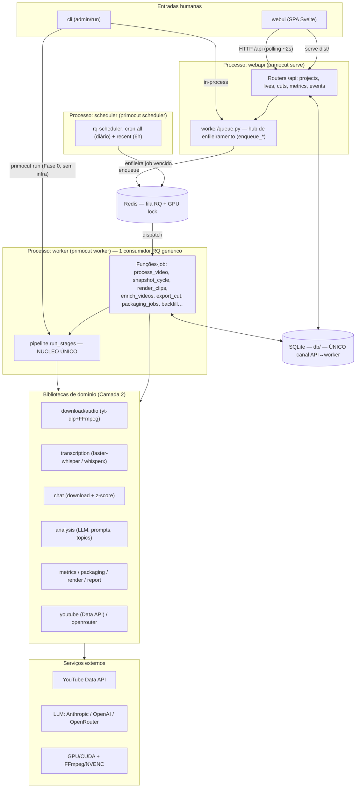

# PRIMOCUT — Mapa de Componentes

> **Nota de idioma.** Por convenção do projeto, todo documento `.md` versionado é
> escrito em inglês (ver `AGENTS.md`). **Este arquivo é a única exceção
> explicitamente autorizada**: é um guia de leitura da arquitetura, escrito em
> português para servir de ponto de reentrada no projeto. Se um dia ele for
> promovido a documentação canônica, deve ser traduzido.

Este documento nomeia **todos** os componentes do PRIMOCUT, explica o escopo de
cada um, quem chama quem, o que cada peça faz e **em que momento** ela entra em
ação. Ele existe para retomar o fio da meada antes da fase de refatoração.

Fontes de verdade que este mapa resume (quando houver contradição, **o código
vence**): produto → `docs/PRIMOCUT.md`; desenvolvimento/roadmap → `docs/DEVELOPMENT.md`;
arquitetura → `README.md`; regras de agente → `AGENTS.md`.

---

## 1. A ideia em uma frase

O PRIMOCUT transforma a **URL de uma live do YouTube** em um **relatório
navegável**: transcrição completa com timestamps clicáveis, atividade de chat por
minuto (picos por z-score = candidatos a clipe) e macro-tópicos opcionais via LLM.
Tudo deriva de timestamps **reais**, então todo link `&t=SECONDS` cai no instante
exato. Sobre essa base cresceram duas fases: **modelagem de concorrentes** (Fase 2)
e **corte assistido / empacotamento de clipes** (Fase 3).

---

## 2. As duas camadas (leia isto antes de tudo)

Os nomes que você provavelmente usa no dia a dia — `webui`, `webapi`, `workers`,
`scheduler`, `cli` — **não são cinco componentes no mesmo nível**. São
**processos executáveis** (unidades de deploy). O que dá forma ao sistema é o que
esses processos **compartilham por baixo**. Sempre pense em duas camadas:

- **Camada 1 — Processos executáveis:** o que você "sobe" (`primocut serve`,
  `primocut worker`, …). São finos: orquestram, mas não contêm a lógica.
- **Camada 2 — Núcleo compartilhado + bibliotecas de domínio:** onde a lógica de
  verdade vive. O pipeline, o banco, os engines, os prompts, as métricas.

> **A única regra que dá forma a tudo:** existe **um** núcleo de pipeline,
> `run_stages` em `src/primocut/pipeline.py`. É o **único** lugar onde a ordem dos
> stages existe. CLI e worker reusam esse núcleo, diferindo apenas pelo `Store` e
> pelo `ProgressReporter` que **injetam**. Nunca duplique a lógica de stage.

---

## 3. Visão geral (diagrama)

---

## 4. Camada 1 — Processos executáveis

Todos são subcomandos de **um único binário Typer** (`primocut …`), cujo ponto de
entrada é `src/primocut/cli.py`. Ou seja: o CLI é ao mesmo tempo um dos componentes
**e** o launcher de todos os outros.

### 4.1 `cli` — `primocut run` (+ administração)

- **Arquivo:** `src/primocut/cli.py`.
- **O que é:** três responsabilidades em um só arquivo:
  1. **Pipeline standalone (Fase 0):** `primocut run <url>` roda o pipeline
     inteiro na própria máquina, in-process, **sem Redis, sem SQLite, sem worker**.
     Usa `FileStore` (caches JSON) + `LogReporter` e escreve um `report.md`. O áudio
     vai para um tempdir descartável — `data/` não é usado.
  2. **Launcher:** `serve`, `worker`, `scheduler` sobem os outros processos.
  3. **Administração:** grupos `projects`, `competitors`, `lives`, `metrics` (com
     `add`/`list`/`remove`/`snapshot`/`enrich`/`show`/`refresh`) e o `export`
     inline — que falam **direto** com DB e fila, sem passar pela API.
- **Comandos avulsos:** `doctor` (valida GPU/CUDA, FFmpeg, yt-dlp, chave do
  provedor, Redis, DB) e `models` (lista modelos do OpenRouter).
- **Quando entra:** operação manual, scripts, dev, e o modo "relatório único" da
  Fase 0.
- **Chama:** `pipeline.run_pipeline` (Fase 0); `worker/queue.py` (enqueue);
  repositórios de `db/`; `metrics/service`.

> ⚠️ **Candidato a refatoração:** `cli.py` (~620 linhas) acumula pipeline +
> launcher + admin. É o arquivo com mais responsabilidades sobrepostas do projeto.

### 4.2 `webapi` — `primocut serve`

- **Arquivos:** `src/primocut/api/` (`app.py` + routers).
- **O que é:** aplicação **FastAPI** servida por uvicorn. `create_app()` monta cinco
  routers *factory-built* (recebem as dependências por injeção para evitar import
  circular) e expõe `/api/health`. Também **serve o SPA já buildado** de
  `src/primocut/webui/dist` na raiz `/`.
- **Papel:** valida requests, lê/escreve no SQLite e **enfileira** trabalho no
  Redis. **Nunca** roda pipeline nem transcrição — delega ao worker.
- **Regra de comunicação:** o **SQLite é o único canal** entre API e worker. Não há
  SSE nem WebSocket; o UI faz **polling (~2s)**.
- **Routers e superfície (todos sob `/api`):**

  | Router | Prefixo | Responsabilidade |
  |---|---|---|
  | `projects.py` | `/projects` | CRUD de projetos (nichos), registro/detach de canais concorrentes, dashboard do projeto, preview + disparo de enrichment, canais próprios |
  | `lives.py` | `/projects/{pid}/lives` | Submeter/listar/detalhar lives, relatório, (re)enqueue, topics, stop, delete. Toda rota `{live_id}` roda o *leakage guard* `repo.get_project_live` (live de outro projeto → 404) |
  | `cuts.py` | `/projects/{pid}/lives/{lid}` | Cut room (Fase 3): cuts, itens, reorder, triage, render, clips/download, export/download, packaging (titles/brief/frames/rank), audience-match, triage de tópicos |
  | `metrics.py` | `/projects/{pid}` | Dashboards de canal/vídeo (**leituras puras**, score computado on-read) + enrichment de um único vídeo |
  | `events.py` | `/projects/{pid}` | Feed do Radar (eventos do nicho), alertas de ops, log de atividade, marca "visto" |

- **Quando entra:** sempre que o produto web está no ar.
- **Chama:** `worker/queue.py` (enqueue), `db/` (repositórios), `api/service.py`
  (montagem do relatório navegável), `metrics/service`.

### 4.3 `worker` — `primocut worker`

- **Arquivo de entrada:** `cli.py::worker` → um `rq.Worker` na fila
  `settings.rq_queue`.
- **Correção importante:** é **um único worker RQ genérico**, não um conjunto de
  workers especializados. Ele executa **qualquer** função enfileirada. O que você
  chama de "os workers" são, na verdade, **funções-job** diferentes:

  | Módulo | Função-job | Disparado por | O que faz |
  |---|---|---|---|
  | `worker/jobs.py` | `process_video` | submissão de live | roda `run_stages` (áudio→transcrição→chat→topics) com `DbStore`+`DbReporter`+GPU lock |
  | `worker/snapshot_jobs.py` | `snapshot_cycle` | **scheduler** (daily/6h) | coleta métricas de concorrentes; detecta vídeos novos e mudanças de packaging; determinístico, **sem LLM** |
  | `worker/event_emission.py` | (passo do cycle) | dentro do `snapshot_cycle` | emite eventos do Radar; `outlier_crossed` com guarda anti-flapping (só sobe de banda) |
  | `worker/comment_collection.py` | (passo do cycle) | dentro do `snapshot_cycle` | coleta top comentários dos outliers que cruzaram (consome `outlier_crossed`, não redetecta) |
  | `worker/channel_jobs.py` | backfill de canal | ao registrar um canal inédito | lista últimos uploads, busca metadados em lote, grava 1º snapshot |
  | `worker/channels.py` | `register_channel`/`detach_channel` | API/CLI (in-request) | resolve o canal e decide inserir+backfill vs. só linkar (dedup global) |
  | `worker/enrich_jobs.py` | `enrich_videos` | ação manual (opt-in, LLM) | enriquece thumbnail/title/comments; isolamento por vídeo + cache por content-hash |
  | `worker/render_jobs.py` | `render_clips` | cut room | baixa a seção + re-encoda os clipes (FFmpeg); isolamento por item + cache por `params_hash` |
  | `worker/export_jobs.py` | `export_cut` | cut room **e** `primocut export` (inline) | empacota o cut (clips+SRT+master concat+manifests, zip) sem mover os originais |
  | `worker/packaging_jobs.py` | `generate_cut_packaging`, `extract_cut_frames`, `rank_cut_frames`, `match_live_audience` | cut room (opt-in) | títulos/briefs (LLM por clipe), extração de frames (só FFmpeg), ranking por visão (LLM), match semântico audiência→tópico |

- **`worker/queue.py` é o hub de enfileiramento** (~540 linhas): concentra todas as
  funções `enqueue_*`, além de `enqueue_video`/`reenqueue_video`/`generate_topics`/
  `stop_video`/`delete_video`/`_default_stopper`. É a **fronteira** que API e CLI
  usam para empurrar trabalho — validam o pedido, persistem estado no SQLite e
  chamam `q.enqueue(...)`.
- **Resiliência transversal:** GPU lock em Redis serializa a transcrição (uma por
  vez entre workers); `QueueUnavailableError` quando o Redis está fora (o
  `redis-py` conecta lazy — só o `enqueue` falha), e os chamadores reconciliam o
  estado já persistido; jobs em lote têm **isolamento por item** (um item ruim não
  desperdiça o lote).
- **Quando entra:** sempre que há trabalho na fila. Sem ele, API e scheduler só
  empilham jobs.

> ⚠️ **Candidato a refatoração:** `worker/queue.py` virou um *god-module* de
> enfileiramento (mistura enqueue de vídeo, render, export, packaging, enrich,
> além de stop/delete/stopper).

### 4.4 `scheduler` — `primocut scheduler`

- **Arquivo:** `src/primocut/worker/scheduler.py` (usa `rq-scheduler`).
- **O que é:** processo que registra **dois crons idempotentes** da **mesma** função
  `snapshot_cycle`, com escopos diferentes: `all` (diário, `snapshot_daily_cron`) e
  `recent` (a cada 6h, `snapshot_recent_cron`, só vídeos < `youtube_recent_days`).
  IDs estáveis (`primocut-snapshot-all` / `-recent`) tornam o registro idempotente:
  reiniciar o scheduler nunca duplica a agenda (cancela os existentes antes).
- **Papel restrito e importante:** ele **só move jobs vencidos para a fila** —
  **nunca executa nada**. Quem executa é o `worker`.
- **Quando entra:** processo de vida longa; a cada disparo do cron.

### 4.5 `webui` — `frontend/` (Svelte 5 + Vite + Tailwind)

- **Diretório:** `frontend/` (fonte); **build** → `src/primocut/webui/dist` (por
  isso o `serve` procura em `webui/dist`, não em `frontend/`).
- **O que é:** SPA de **hash-routing**, **apenas apresentação** — zero lógica de
  negócio, **nunca** toca DB/fila/pipeline. Fala com o backend só via `lib/api.js`
  (fetch em `/api`), com **polling**.
- **Roteamento** (`lib/router.js`) → **views** (`src/views/`):

  | Rota (hash) | View | Papel |
  |---|---|---|
  | `#/` | `Radar` | home cross-project: feed de eventos de todos os nichos |
  | `#/activity` | `Activity` | log de atividade completo |
  | `#/p/{pid}/lives` | `Lives` | lista de lives do projeto + status do pipeline |
  | `#/p/{pid}/lives/{lid}` | `CutRoom` | corte assistido (Fase 3): triage, render, packaging |
  | `#/p/{pid}/niche[/{tab}]` | `Niche` | patterns / outliers / channels do nicho |
  | `#/p/{pid}/niche/channels/{cid}` | `ChannelDashboard` | drill-down de um canal concorrente |
  | `#/.../videos/{vid}` | `VideoDetail` | detalhe de um vídeo concorrente |
  | `#/p/{pid}/settings` | `Settings` | canais próprios + bandas (read-only) |

- **Componentes compartilhados:** `Sidebar`, `Player`, `PipelinePanel`,
  `PipelineRail`, `DistributionStrip`. Utilitários em `lib/` (`api`, `events`,
  `format`, `steps`, `router`).
- **IA (arquitetura de informação):** Radar/Activity globais **acima** de
  Lives/Niche/Settings por projeto (ver `docs/PRIMOCUT.md` § Interface).
- **Quando entra:** carregado pelo `serve` a partir de `dist/`.

---

## 5. Camada 2 — Núcleo compartilhado e domínio

Aqui vive a lógica de verdade. Os processos da Camada 1 são finos: eles injetam
dependências e chamam esta camada.

### 5.1 `pipeline.py::run_stages` — o núcleo único

- **Fluxo:** Metadata → Áudio → Transcrição → Chat (opcional) → Análise (topics,
  **opt-in** via `create_topics`).
- **É o único lugar onde a ordem dos stages existe.** CLI e worker chamam esta
  mesma função, diferindo só pela **injeção**:
  - **CLI:** `FileStore` + `LogReporter` + tempdir + **sem** GPU lock.
  - **Worker:** `DbStore` + `DbReporter` + **GPU lock** (Redis).
- **Cache e resiliência:** cada stage consulta o `store` antes de trabalhar
  (re-enqueue é idempotente — pula o que já está persistido). Metadata e análise são
  **degradáveis** (falha vira warning); áudio e transcrição são **essenciais**
  (falha → `PipelineError` e aborta com mensagem clara). O cache de topics só grava
  em sucesso pleno.
- **`run_pipeline`** é o wrapper Fase 0 (só CLI): monta `FileStore`+`LogReporter`,
  roda `run_stages` e escreve o `report.md`.

### 5.2 O *seam* de injeção — `store.py` e `progress.py`

Esta é a costura mais importante do projeto (e a que a refatoração precisa
preservar):

- **`Store`** (`store.py`): `FileStore` (JSON em disco, CLI) vs. `DbStore`
  (SQLite, worker). Abstrai cache/persistência dos artefatos.
- **`ProgressReporter`** (`progress.py`): `LogReporter` (loga, CLI) vs. `DbReporter`
  (grava status/progresso/stage no SQLite para o UI ler via polling).

### 5.3 `db/` — SQLite + repositórios

Não é "só um banco": é um **componente arquitetural** — o **único canal**
API↔worker.

- `session.py` — engine, sessão, aplicação de migrações.
- `models.py` — modelos ORM/linha.
- Repositórios por domínio: `repo` (vídeos/jobs/stages), `competitors`, `cuts`,
  `clips`, `exports`, `events`, `packaging`.
- `migrations/` — SQL versionado (`002_…` a `010_…`).

### 5.4 Bibliotecas de domínio

Chamadas por `run_stages` e/ou pelas funções-job:

- **`download/audio.py`** — valida URL, extrai `video_id`, baixa/normaliza áudio
  (yt-dlp + FFmpeg). Áudio é **efêmero** (tempdir, descartado por run/job).
- **`transcription/`** — engines `faster_whisper_engine.py` e
  `whisperx_engine.py` atrás de `engine.py`. **Sem fallback de CPU** (por decisão).
  Alinhamento fino do WhisperX roda em `render/align_worker.py`, um **subprocesso**
  num venv separado (capacidade opcional da Fase 3).
- **`chat/`** — `downloader.py` (baixa o chat) + `signals.py` (atividade por minuto,
  picos por **z-score** = candidatos a clipe).
- **`analysis/`** — `llm.py` (provider abstrato), `prompts.py`/
  `enrichment_prompts.py`/`packaging_prompts.py`, `parse.py`, `windowing.py`,
  `consolidate.py`, `runner.py`, `topics.py`.
  - **Regra de ouro:** o LLM só devolve **índices** de segmento, **nunca**
    timestamps. A resolução índice→tempo vive em `models.py::resolve_span` (clampa
    para segmentos reais). Nenhum prompt/parser confia em tempo emitido pelo modelo.
- **`metrics/`** — scores de concorrentes **computados on-read** (`core`, `impact`,
  `patterns`, `attributes`, `comments`, `packaging_signals`, `enrichment`) +
  `service.py` (monta os payloads de dashboard).
- **`packaging/`** + **`render/`** — geração de títulos/briefs
  (`packaging/generate.py`), extração/ranking de frames (`render/frames.py`),
  `encode`, `section`, `align`, `package` (bundle de entrega), `report/markdown.py`
  (só CLI).
- **`youtube/`** — `client.py` (YouTube Data API, com contabilização de quota),
  `resolve.py`, `thumbnails.py`. **`openrouter.py`** — catálogo de modelos.
- **Transversais:** `config.py` (`Settings`/env, prefixo `PRIMOCUT_`), `doctor.py`,
  `gpu.py` (GPU lock em Redis), `resilience.py`, `logging_conf.py`, `models.py`
  (modelos de domínio + `resolve_span`).

---

## 6. Infra e serviços externos (não esqueça deles)

- **Redis** — faz **dois** papéis: broker do RQ (a fila) **e** o **GPU lock** que
  serializa a transcrição. Fora do ar → `enqueue` falha (`QueueUnavailableError`),
  já reconciliado pelo código.
- **SQLite** — persistência **e** canal de comunicação API↔worker.
- **YouTube Data API** — métricas/uploads/comentários de concorrentes (quota
  contabilizada).
- **Provedores LLM** — Anthropic / OpenAI / OpenRouter (topics, enrichment,
  packaging, ranking por visão). Todo uso de LLM é **opt-in** e custa (guideline 9).
- **yt-dlp + FFmpeg/NVENC + GPU/CUDA** — download, transcode, render, upscale.
- **Venv separado do WhisperX** — subprocesso para alinhamento (Fase 3, opcional).

---

## 7. Fluxos ponta a ponta (quem chama quem, e quando)

**Fluxo A — CLI standalone (Fase 0).**
`primocut run` → `run_pipeline` → `run_stages` (`FileStore`/`LogReporter`) →
`report.md`. Síncrono, sem infra.

**Fluxo B — pipeline web (uma live).**
UI ou `lives add` → `POST /api/projects/{pid}/lives` → `enqueue_video` grava
Video+Job no SQLite e enfileira `process_video` → **worker** roda `run_stages`
(`DbStore`/`DbReporter`, GPU lock) → grava progresso/artefatos no SQLite → UI vê o
status subir por **polling**.

**Fluxo C — coleta de concorrentes (background contínuo).**
**scheduler** dispara `snapshot_cycle` (daily `all` / 6h `recent`) → fila →
**worker** executa → dentro do cycle: detecta vídeos novos, mudanças de packaging
(título por string; thumbnail por **hash de bytes**, a URL não é confiável), emite
eventos do Radar (`event_emission`) e coleta comentários dos outliers que cruzaram
(`comment_collection`). **Determinístico, zero LLM.**

**Fluxo D — cut room / entrega (Fase 3).**
UI (`CutRoom`) → router `cuts.py` → `enqueue_render` / `enqueue_packaging` /
`enqueue_frame_*` / `enqueue_export` → worker roda os jobs → clips/bundles em disco
(`clips_dir` / `exports_dir`), baixáveis pela API. `primocut export` faz o mesmo
**inline**.

**Fluxo E — enrichment / métricas (opt-in, custa LLM).**
`metrics enrich` ou botão no UI → `enqueue_enrichment` → worker `enrich_videos`. Os
dashboards (`metrics.py`) são **leituras puras**, computadas on-the-fly sobre os
snapshots.

---

## 8. Componentes que costumam ser esquecidos

Checklist rápido do que **não** aparece na lista "webui/webapi/workers/scheduler/cli"
mas é parte essencial do sistema:

1. **O núcleo `run_stages`** — o verdadeiro coração; os processos só o embrulham.
2. **O *seam* `Store`/`ProgressReporter`** — a injeção que mantém CLI e web idênticos.
3. **`db/` (SQLite)** — não é infra passiva; é o canal de comunicação.
4. **`worker/queue.py`** — o hub de enfileiramento (fronteira API/CLI → fila).
5. **Redis com papel duplo** — fila **e** GPU lock.
6. **O worker é UM só e genérico** — múltiplas funções-job, não múltiplos workers.
7. **`snapshot_cycle` + `event_emission` + `comment_collection`** — a máquina de
   concorrentes que roda dentro do worker, orquestrada pelo scheduler.
8. **Bibliotecas de domínio** — transcription/chat/analysis/metrics/packaging/render/
   youtube — onde a lógica realmente mora.
9. **Serviços externos** — YouTube Data API, LLMs, yt-dlp, FFmpeg/NVENC, GPU, venv
   do WhisperX.
10. **`doctor` / `config` / `resilience` / `gpu`** — a espinha operacional.

---

## 9. Candidatos naturais à refatoração (para a próxima fase)

Observações estruturais colhidas na leitura — pontos de partida, não veredictos:

- **`cli.py` (~620 linhas)** acumula três papéis (pipeline Fase 0 + launcher +
  administração que fala direto com DB/fila). Separar o "run" standalone dos
  subcomandos de admin reduziria bastante o acoplamento.
- **`worker/queue.py` (~540 linhas)** é um *god-module* de enfileiramento (vídeo,
  render, export, packaging, enrich, stop, delete). Um enqueue por domínio deixaria
  cada fronteira coesa.
- **Fronteira `metrics/` vs. `packaging/` vs. `render/`** — há sobreposição
  conceitual (sinais de packaging, atributos, impacto) que vale delimitar.
- **`api/` factory-built** é limpo, mas os routers já são grandes (`cuts.py` com
  ~20 rotas). Avaliar sub-routers por capacidade (triage vs. render vs. packaging).
- **Preservar acima de tudo** o núcleo `run_stages` e o *seam* `Store`/
  `ProgressReporter`: é o que garante que CLI e web nunca divirjam.

---

*Documento gerado como mapa de reentrada antes da fase de refatoração. Em caso de
divergência com o código, o código vence — e então corrija este mapa.*
